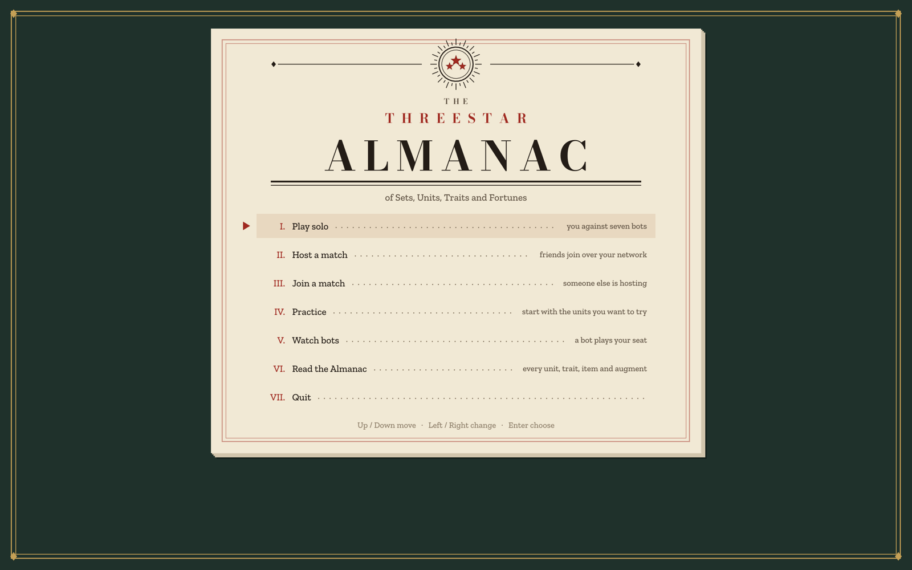
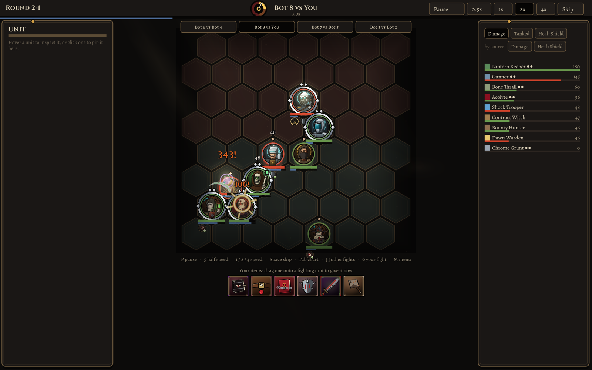
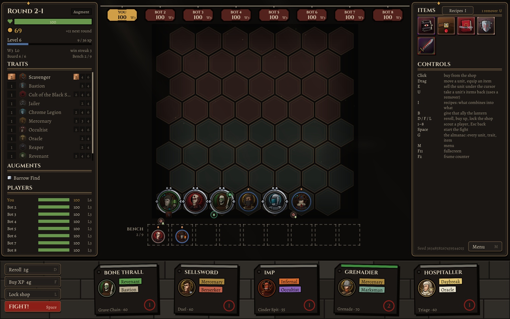
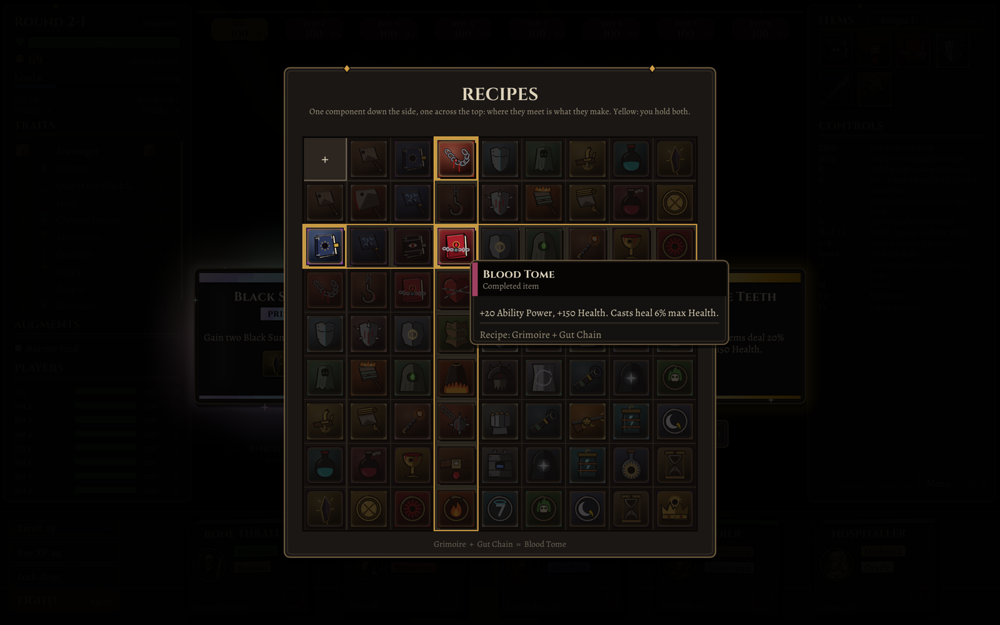
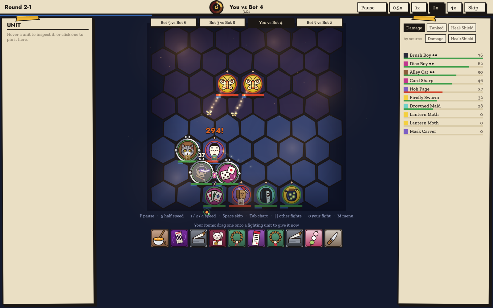
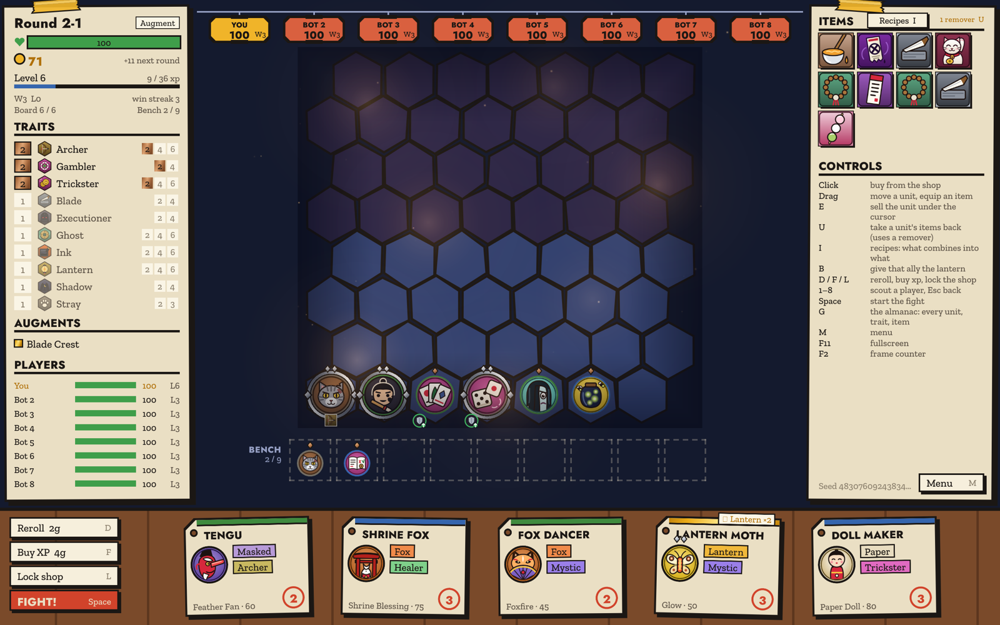
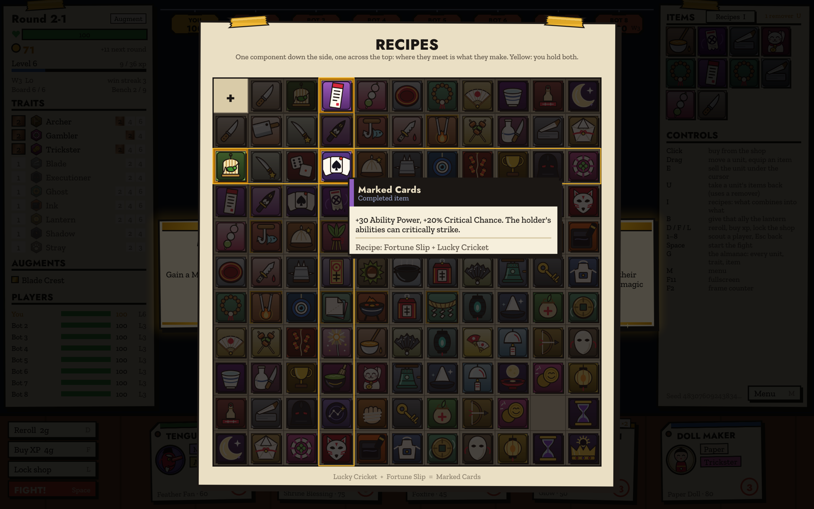

# Threestar Almanac

An autobattler. This repository holds its releases only.

**Dead Sun**: gothic, under a dying sun that sets at Dusk and goes out at the Eclipse.

| | |
|---|---|
|  |  |
|  | |

**Night Market**: ink and paper under strung lanterns.

| | |
|---|---|
|  |  |
|  | |

**To play**, download the launcher for your system once:

- Mac: [Threestar-Almanac-mac.zip](https://github.com/medsrk/Almanac/releases/download/launcher/Threestar-Almanac-mac.zip). Unzip, drag the app to Applications; the first time, right-click it and choose Open.
- Windows: [Threestar-Almanac-windows.zip](https://github.com/medsrk/Almanac/releases/download/launcher/Threestar-Almanac-windows.zip). Unzip and run it; if SmartScreen stops it, choose More info, then Run anyway.

The launcher installs the game and keeps it up to date every time you open it.

**Guides**, every unit, trait, item and augment in each set: [Night Market](https://medsrk.github.io/Almanac/guides/night_market.html) and [Dead Sun](https://medsrk.github.io/Almanac/guides/dead_sun.html).
